

# قاعدة بيانات رَقَم — المخطط الكامل (3NF)

المصدر: `database/raqam_schema.sql` (PostgreSQL 16). المخططات أدناه مولّدة تلقائياً من قاعدة البيانات نفسها.

**131** جدول | **197** مفتاح أجنبي | **222** قيد CHECK | **381** فهرس | **45** Trigger | **80 + 18** اختبار ناجح

## 1NF — قيم ذرية بدون قوائم داخل الحقول

| قبل | بعد |
|---|---|
| posts.extra (JSON لحقول كل نوع) | 7 جداول فرعية: podcast_episodes، success_stories، products، history_entries، initiatives، roundtable_sessions، awareness_cards (+ infographics) |
| «أرقام بارزة» كمصفوفة | success_story_figures: صف لكل رقم |
| روابط سوشيال الكاتب/الضيف كـ JSON | author_links و guest_links مع جدول social_platforms |
| services.deliverables كـ JSON | service_deliverables: صف لكل بند |
| صيغ وكلمات وأزرار البوت كـ JSON | bot_entry_variants، bot_entry_keywords، bot_entry_quick_replies، وأفعال بمفاتيح أجنبية واضحة |
| home_blocks.settings كـ JSON | أعمدة واضحة (category_id، section_id، playlist_id…) مع CHECK لكل نوع |
| خصائص الصورة (alt، تعليق، نقطة تركيز) كـ JSON | أعمدة في media_assets، والنسخ المصغرة في media_variants |
| الطقس كـ JSON | weather_observations و weather_forecasts + weather_conditions |
| بنود الفاتورة كـ JSON | invoice_lines |
| تغييرات سجل العمليات كـ JSON | audit_log_changes: صف لكل حقل تغيّر (قبل/بعد) |

## 2NF — كل حقل يعتمد على المفتاح المركّب كاملاً

| الجدول | السبب |
|---|---|
| post_guests (post_id, guest_id) | الدور (مقدّم/ضيف/مشارك) يعتمد على المادة والضيف معاً |
| playlist_videos (playlist_id, video_id) | الترتيب يعتمد على القائمة والفيديو معاً |
| ad_stats_daily (campaign, placement, date) | المشاهدات والنقرات تعتمد على المفتاح كاملاً |
| character_poses (character, pose) | صورة الوضعية تعتمد على الشخصية والوضعية معاً |

## 3NF — بدون اعتماد غير مباشر وبدون قيم محسوبة مخزنة

| أُزيل | البديل |
|---|---|
| posts.section_id | القسم يُعرف من نوع المادة: post_kinds.section_id (مادة ← نوع ← قسم) |
| awareness_cards.character_id | الشخصية تُعرف من الوضعية: character_poses.character_id |
| قطاع ومدينة وسنة تأسيس قصة النجاح | صفات الشركة نفسها ← جدول organizations |
| اسم الراعي وبيانات المعلن | organizations + advertisers |
| اسم وإيميل وهاتف العميل بكل حجز | customers، والحجز يشير إليه |
| is_breaking، is_sponsored، حالة «منتهية» للإعلان | تُستنتج: breaking_until > now()، sponsor_organization_id، ends_at |
| views_total، messages_count، hits، last_login_at | تُحسب من جداولها (Materialized View أو استعلام) |
| مجموع وضريبة الفاتورة | View اسمه invoice_totals يحسبها من البنود |
| عملة الاسترجاع، الحالة السابقة بسجل الحجز | عملة الدفعة نفسها، والصف السابق بالسجل |
| RQ-2026-00042 و INV-2026-00001 | أعمدة Generated تُبنى من (السنة، التسلسل) تلقائياً |
| أسعار الدرهم والريال وجدول «سعر الإغلاق» | الدرهم والريال يُحسبان من الدولار عبر currency_pegs، والسعر السابق من نفس جدول الأسعار (نشرة يومية) |
| صور وفيديوهات داخل نص الخبر (مخفية بالـ HTML) | post_body_media و post_body_videos: كل استخدام مسجّل ومحمي من الحذف |

## استثناءات مقصودة وموثقة

| العنصر | السبب |
|---|---|
| payment_events.payload (jsonb) | نسخة أرشيفية لرسالة البنك كما وصلت، لا تُقرأ حقلاً حقلاً |
| failed_jobs و job_batches (payload، exception، failed_job_ids، options) | بيانات داخلية لطوابير Laravel (مهمة مسلسلة ورسالة الخطأ) بالشكل اللي بيقرأه الإطار، لا تُقرأ حقلاً حقلاً، والمهام الفاشلة تنحذف بعد 30 يوماً |
| invoices.billed_* و bookings.price_amount | لقطة تاريخية قانونية لحظة الإصدار/الحجز، ولا تتغير إذا تغيّر العميل أو السعر |
| bookings.status_code مع سجل المراحل | الحالة الحالية لا تتغير إلا بإضافة صف للسجل، وTrigger يمنع أي تعديل مباشر |
| audit_log.subject_table / subject_id | بدون مفتاح أجنبي عمداً: السجل لازم يبقى حتى لو انحذف الشيء |
| أعمدة search_* (مثل posts.search_text) | نسخة موحّدة الحروف للبحث، تحسبها قاعدة البيانات بنفسها (Generated) فما بتختلف عن الأصل أبداً |

## قابلية التوسع

| الحالة | كيف |
|---|---|
| نوع مادة جديد | صف في post_kinds + جدول فرعي جديد، بدون أي تعديل على posts |
| قوائم قابلة للإضافة | الحالات والانتقالات، أماكن الإعلانات، المزوّدون، المنصات، القطاعات، الحقب، أنواع الأحداث: كلها جداول وليست قيم ثابتة بالكود |
| تبديل المزوّدين | data_providers: مزوّد أساسي واحد لكل خدمة، واحتياطي جاهز |
| أي عملة | كل مبلغ مرتبط بجدول currencies |
| فريق إدارة لاحقاً | roles و permissions و user_roles جاهزة |
| التخزين | عمود disk في media_assets (local أو r2) للنقل إلى Cloudflare R2 |
| الحجم الكبير | الجداول الزمنية (الأسعار، الطقس، المشاهدات، السجل) جاهزة للتقسيم الشهري (Partitioning) بدون تغيير في التطبيق |
| السرعة | فهرس على كل مفتاح أجنبي، وفهارس جزئية للمنشور فقط، و pg_trgm للبحث البديل |

## ميزات PostgreSQL المستخدمة

| الميزة | ببساطة | مثال عندنا |
|---|---|---|
| Domains | قاعدة وحدة لكل نوع بيانات (slug، إيميل، هاتف، رابط، مبلغ) | slug_text يرفض التشكيل والمسافات |
| CHECK | قاعدة البيانات ترفض القيم الغلط بنفسها | لا نشر بدون صورة رئيسية ونص |
| Partial index | فهرس على جزء من الصفوف | مدينة افتراضية وحدة، دفعة ناجحة وحدة لكل حجز |
| EXCLUDE | يمنع تداخل الفترات الزمنية | تعديلين يدويين لنفس العملة ما بيتداخلوا |
| Composite FK | يربط الجدول الفرعي بالنوع الصحيح | ما بتنضاف بيانات حلقة لمادة نوعها خبر |
| Deferred trigger | فحص عند حفظ المعاملة كاملة | مادة القسم لازم يكون إلها جدولها الفرعي قبل النشر |
| Deferrable unique | ترتيب مؤقت مكرر داخل المعاملة | سحب وإفلات ترتيب الفيديوهات |
| Generated column | عمود يحسب نفسه | الرقم المرجعي للحجز ورقم الفاتورة |
| دالة normalize_ar | توحيد الحروف العربية (أ/إ/آ، ة/ه، ى/ي، التشكيل، الأرقام) | نفس الدالة بالـ PHP، ومختبرة إنها بتعطي نفس النتيجة |
| pg_trgm | بحث تقريبي بيتحمل الأخطاء | «الدولر» بتلاقي «الدولار» لو توقف Meilisearch |
| Triggers | منطق داخل قاعدة البيانات | سجل العمليات غير قابل للتعديل، الفواتير ثابتة |
| Materialized view | نتيجة محسوبة تتحدث كل ساعة | مجموع مشاهدات كل مادة |
| citext / timestamptz | إيميل بدون حساسية أحرف، وقت عالمي UTC | كل الإيميلات وكل الأوقات |

## المخططات حسب الوحدة

> `users` و `media_assets` و `seo_meta` تُرسم في وحداتها فقط لأنها مرتبطة بأغلب الجداول. جداول Laravel (sessions، jobs، cache…) تُنشأ من الإطار نفسه.

### الهوية والصلاحيات — Identity & access

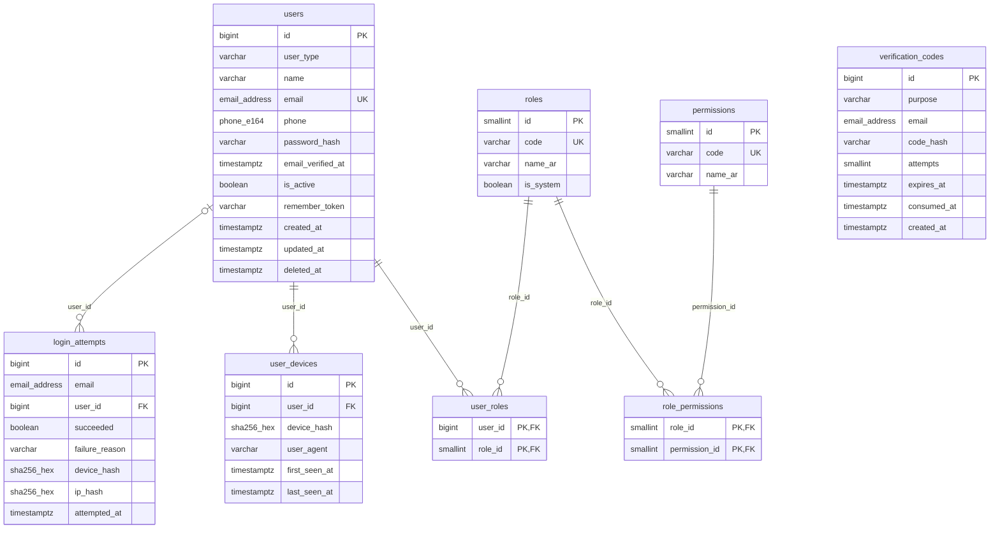

### المنصة والإعدادات — Platform & settings

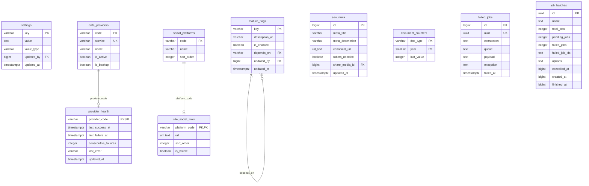

### الوسائط — Media

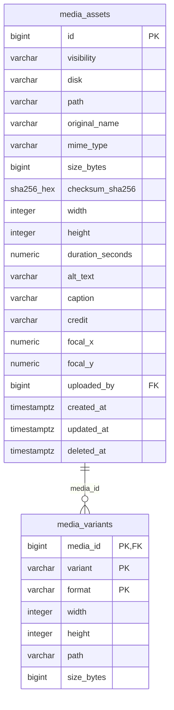

### البيانات المرجعية — Reference data

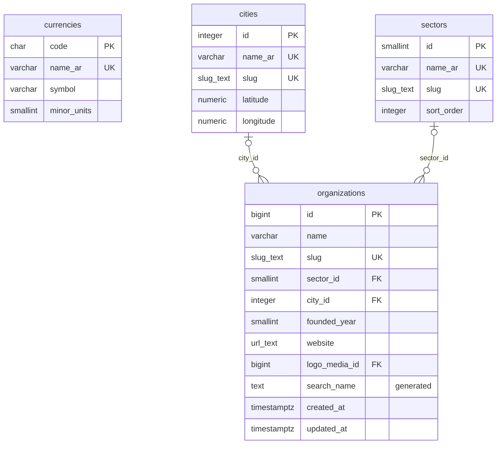

### الأقسام والتصنيفات والأشخاص — Taxonomy & people

```mermaid
erDiagram
  sections {
    smallint id PK
    varchar key UK
    varchar name_ar
    slug_text slug UK
    text description
    bigint cover_media_id FK
    bigint seo_meta_id FK,UK
    integer sort_order
    boolean is_visible
    timestamptz created_at
    timestamptz updated_at
  }
  categories {
    integer id PK
    integer parent_id FK
    varchar name_ar
    slug_text slug UK
    text description
    boolean is_highlighted
    bigint seo_meta_id FK,UK
    integer sort_order
    boolean is_active
    timestamptz created_at
    timestamptz updated_at
  }
  tags {
    bigint id PK
    varchar name_ar UK
    slug_text slug UK
    bigint seo_meta_id FK,UK
    text search_name "generated"
    timestamptz created_at
  }
  eras {
    smallint id PK
    varchar name_ar UK
    smallint year_from
    smallint year_to
    integer sort_order
  }
  authors {
    bigint id PK
    varchar name
    slug_text slug UK
    varchar job_title
    text bio
    bigint photo_media_id FK
    bigint user_id FK,UK
    boolean is_active
    smallint team_sort_order
    bigint seo_meta_id FK,UK
    text search_name "generated"
    timestamptz created_at
    timestamptz updated_at
    timestamptz deleted_at
  }
  author_links {
    bigint author_id PK,FK
    varchar platform_code PK,FK
    url_text url
  }
  guests {
    bigint id PK
    varchar name
    slug_text slug UK
    varchar job_title
    bigint organization_id FK
    text bio
    bigint photo_media_id FK
    bigint seo_meta_id FK,UK
    text search_name "generated"
    timestamptz created_at
    timestamptz updated_at
    timestamptz deleted_at
  }
  guest_links {
    bigint guest_id PK,FK
    varchar platform_code PK,FK
    url_text url
  }
  guest_roles {
    varchar code PK
    varchar name_ar UK
  }
  authors ||--o{ author_links : "author_id"
  categories |o--o{ categories : "parent_id"
  guests ||--o{ guest_links : "guest_id"
  organizations |o--o{ guests : "organization_id"
  social_platforms ||--o{ author_links : "platform_code"
  social_platforms ||--o{ guest_links : "platform_code"
```

### المحتوى — Content

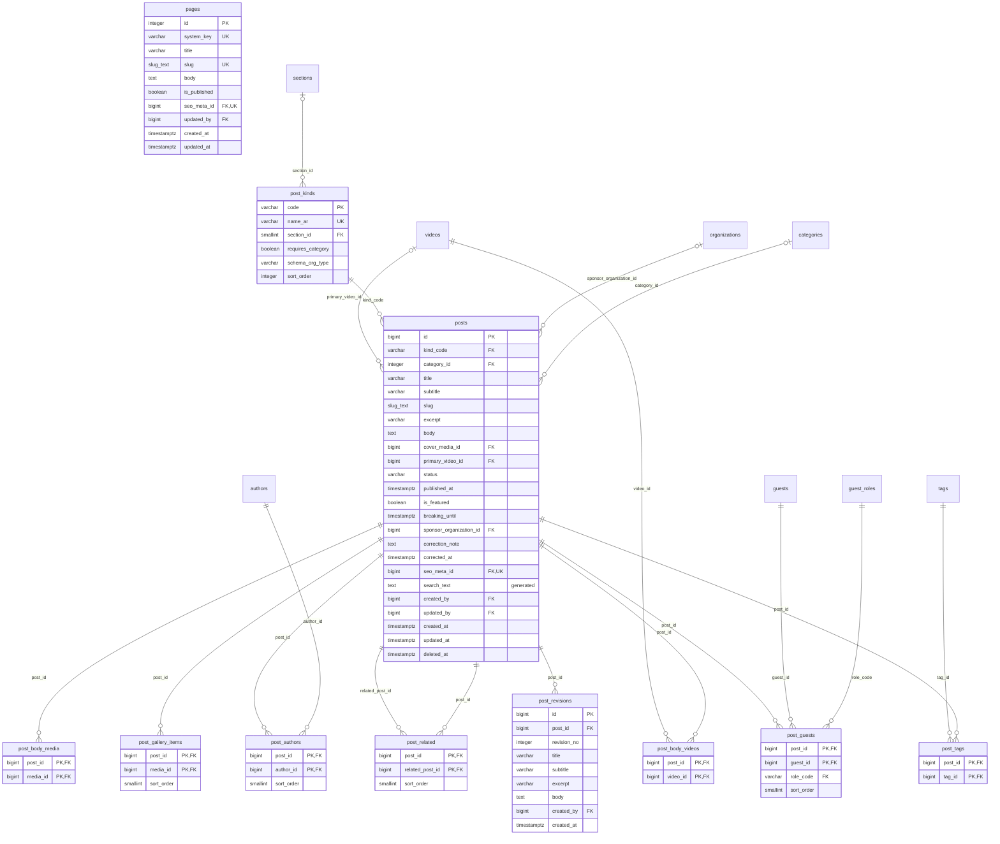

### أنواع المواد الخاصة — Post subtypes

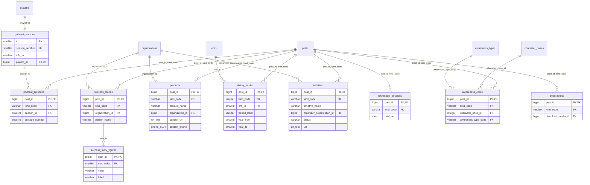

### الفيديو والشخصيات — Video & characters

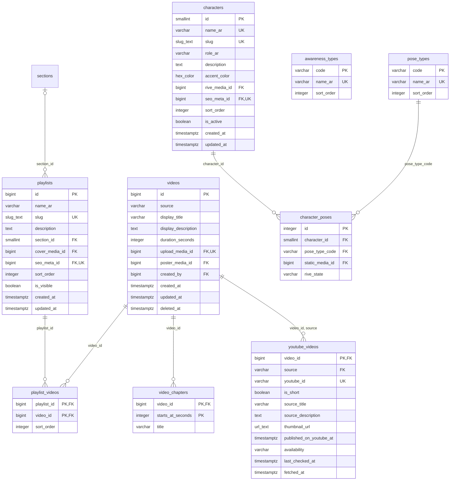

### العملات والطقس — Currency & weather

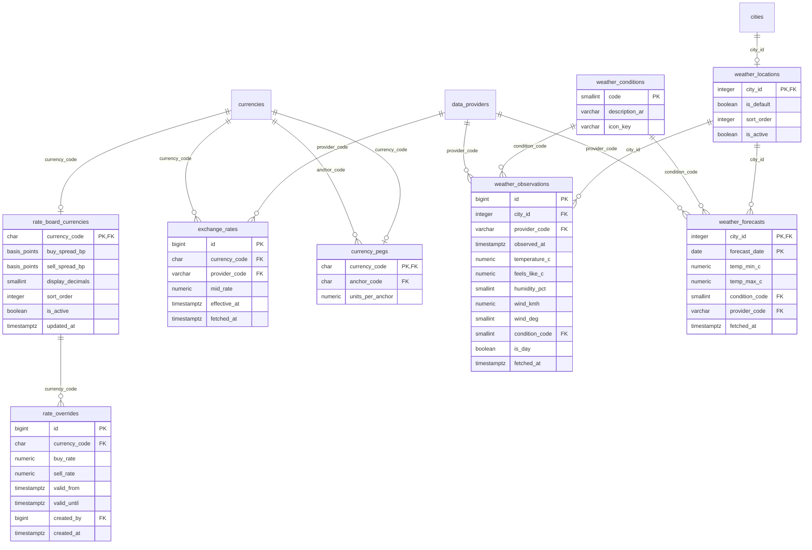

### الإعلانات — Advertising

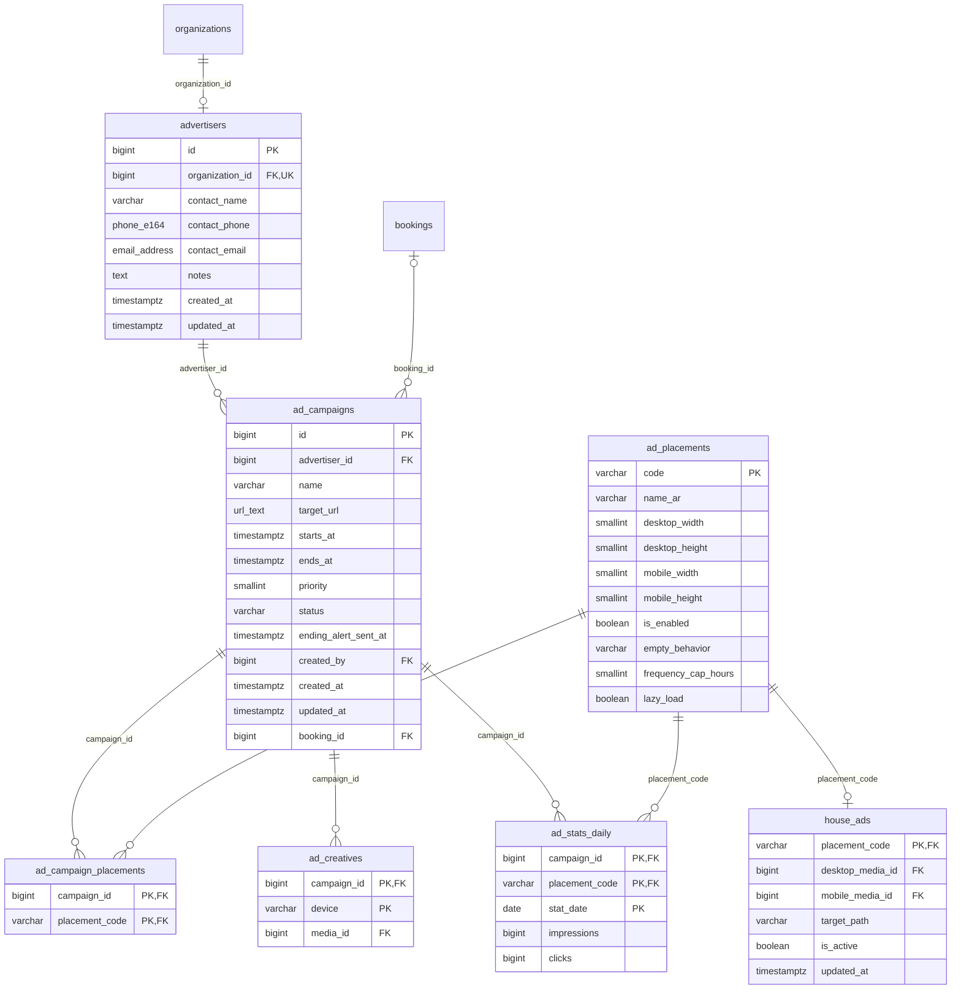

### الخدمات والحجز — Services & booking

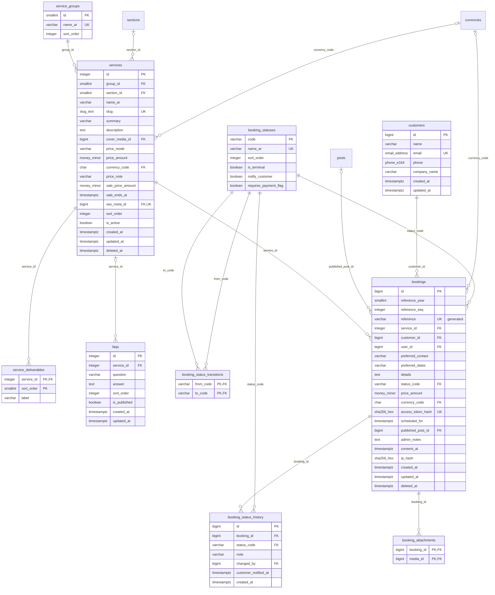

### الدفع والفواتير — Payments & invoices

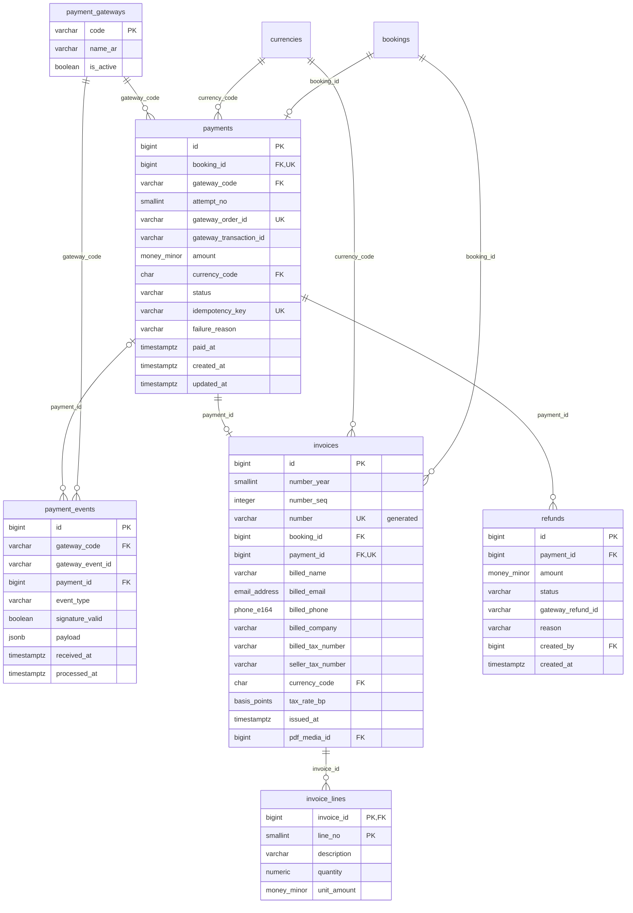

### حسابات العملاء — Customer accounts

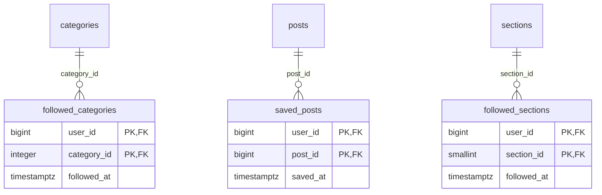

### الشات بوت — Chatbot

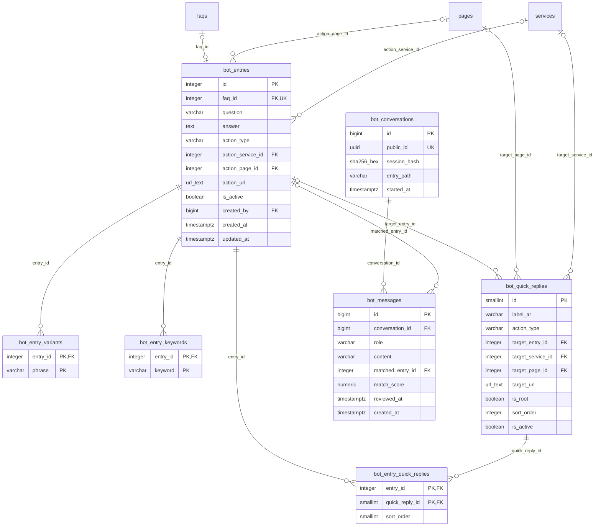

### النشرة والرسائل — Newsletter & messaging

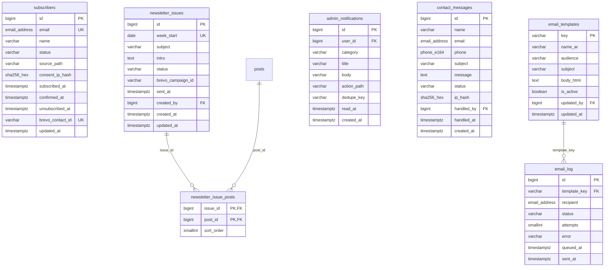

### SEO والبحث والتنقل — SEO, search & navigation

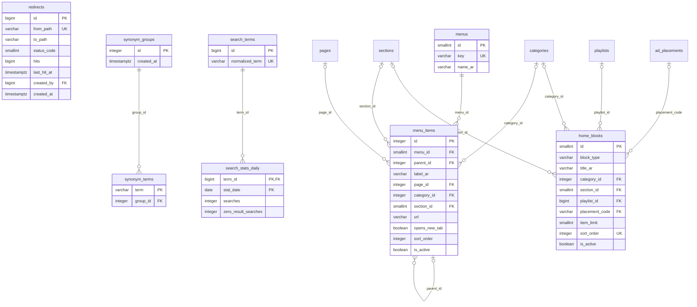

### الإحصائيات وسجل العمليات — Analytics & audit

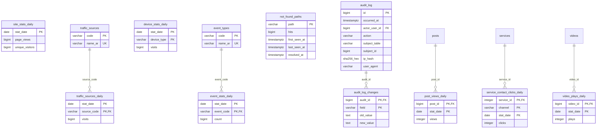

